# Alur Sistem — Spencer's Indonesia Landing Page

Dokumen ini menjelaskan semua alur **Pengunjung (User)** dan **Admin** dalam bentuk flowchart.
Diagram ditulis dengan Mermaid, jadi langsung tampil sebagai gambar di GitHub.

Daftar isi

1. [Gambaran sistem](#1-gambaran-sistem)
2. [Alur pengunjung membuka landing page](#2-alur-pengunjung-membuka-landing-page)
3. [Alur data kunjungan (Laporan)](#3-alur-data-kunjungan-laporan)
4. [Alur login, sesi & logout admin](#4-alur-login-sesi--logout-admin)
5. [Peta menu admin](#5-peta-menu-admin)
6. [Alur Halaman: daftar, template, arsip](#6-alur-halaman-daftar-template-arsip)
7. [Alur editor halaman (draft → Simpan)](#7-alur-editor-halaman-draft--simpan)
8. [Alur upload gambar & HTML](#8-alur-upload-gambar--html)
9. [Alur Promo (draft → Publish)](#9-alur-promo-draft--publish)
10. [Aturan promo mana yang tampil](#10-aturan-promo-mana-yang-tampil)
11. [Alur Laporan & Dashboard](#11-alur-laporan--dashboard)
12. [Alur deploy (GitHub → Vercel)](#12-alur-deploy-github--vercel)

---

## 1. Gambaran sistem

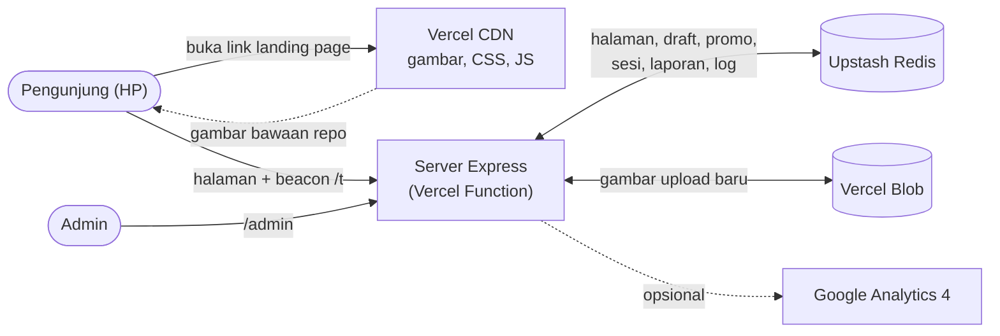

| Bagian | Isi |
| --- | --- |
| Landing page | `/{slug}`, contoh `/slimmealsolutionmintidn2`. Mobile-first, lebar desain 320 unit. |
| Admin | `/admin` → Dashboard, Laporan, Halaman, Promo, Logout. |
| Penyimpanan | Lokal: folder `data/` + `public/uploads/`. Di Vercel: Redis (data) + Blob (gambar baru). |

---

## 2. Alur pengunjung membuka landing page

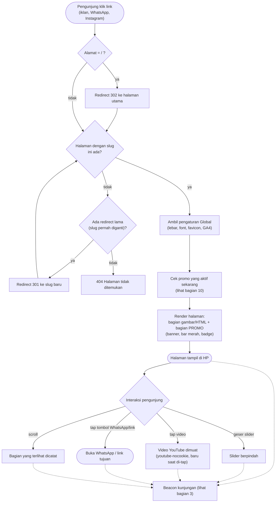

Catatan

- Bagian yang **disembunyikan** di admin tidak dikirim ke pengunjung.
- Halaman tidak memakai cookie. GA4 hanya aktif jika Measurement ID diisi di tab Global.

---

## 3. Alur data kunjungan (Laporan)

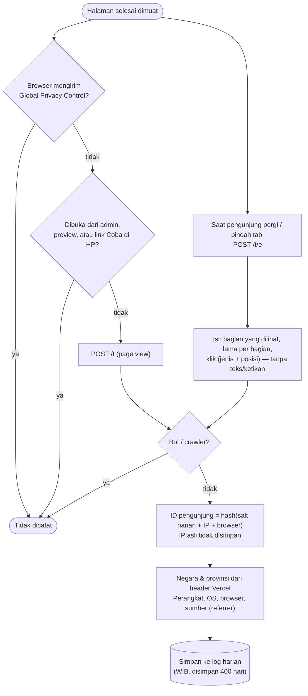

---

## 4. Alur login, sesi & logout admin

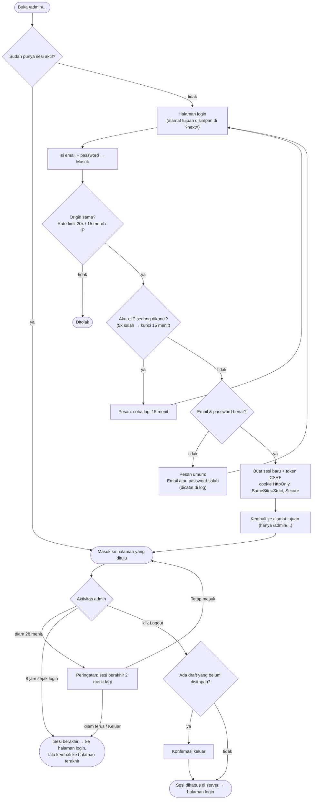

---

## 5. Peta menu admin

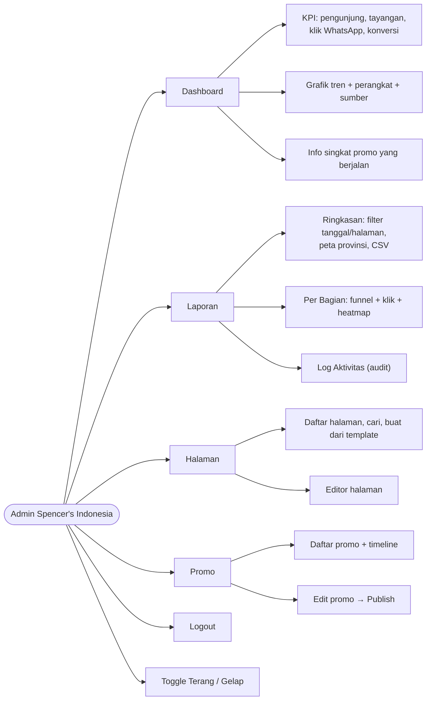

Titik oranye di menu Halaman berarti ada draft halaman yang belum disimpan. Titik oranye di menu Promo berarti ada draft promo yang belum dipublish.

---

## 6. Alur Halaman: daftar, template, arsip

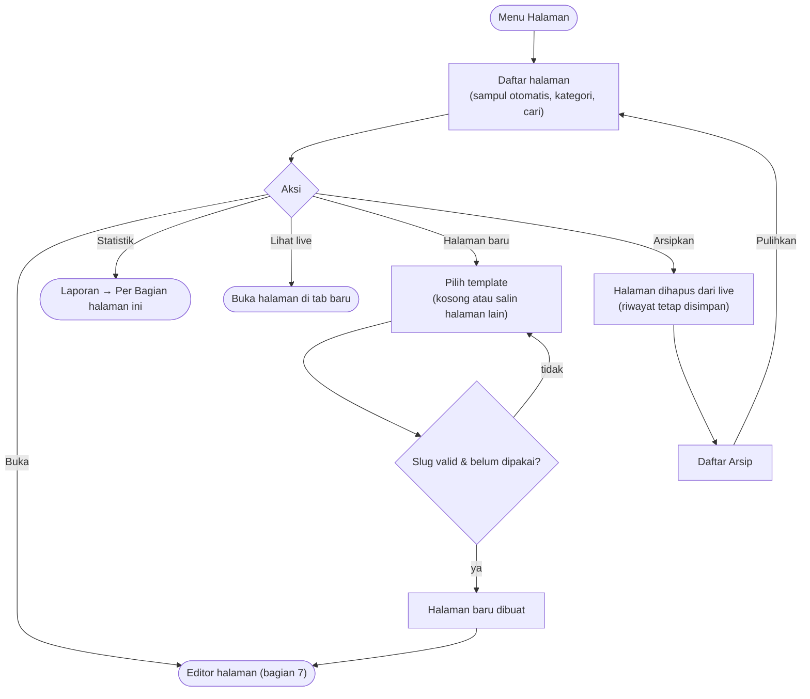

---

## 7. Alur editor halaman (draft → Simpan)

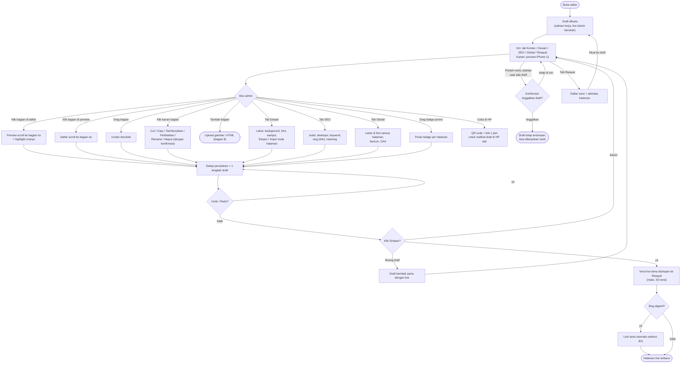

Editor juga menampilkan peringatan jika promo yang aktif belum punya banner atau badge.

---

## 8. Alur upload gambar & HTML

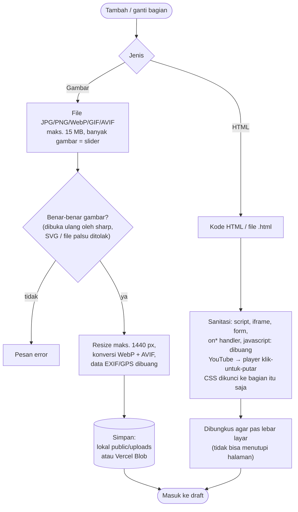

---

## 9. Alur Promo (draft → Publish)

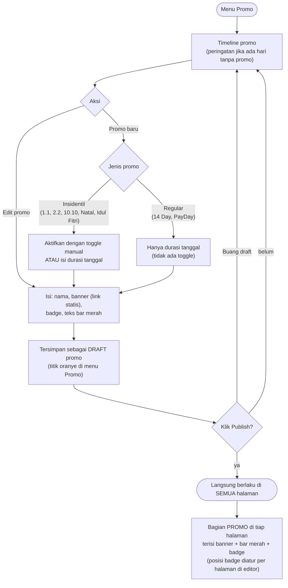

---

## 10. Aturan promo mana yang tampil

Hanya **satu** promo yang tampil pada satu waktu. Urutannya dicek dari atas ke bawah:

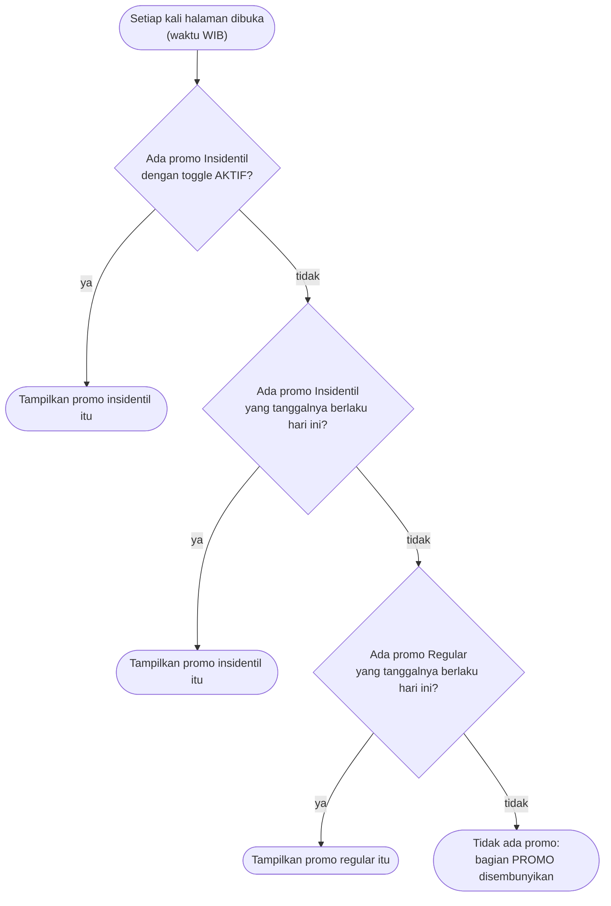

Jadi jika promo Insidentil diaktifkan, promo Regular otomatis tidak tampil (statusnya menjadi *tertimpa*).

---

## 11. Alur Laporan & Dashboard

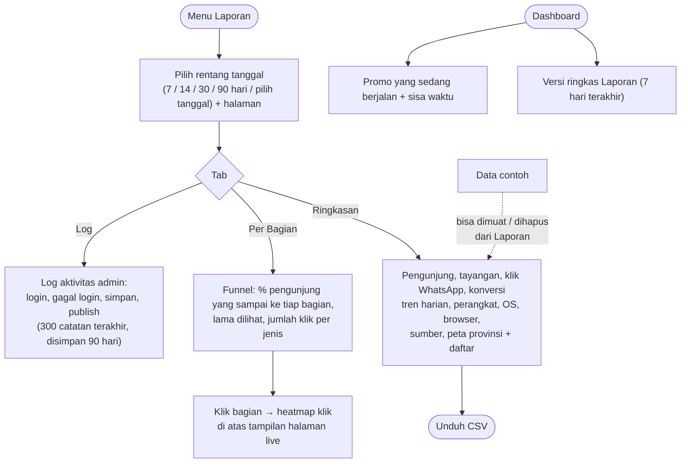

---

## 12. Alur deploy (GitHub → Vercel)

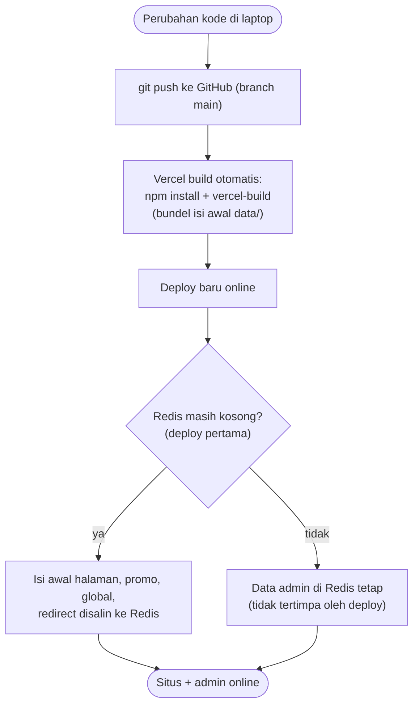

Penting

- Setelah online, **konten diubah lewat admin**, bukan lewat file `data/` di repo. Deploy ulang tidak menimpa isi Redis.
- Variabel rahasia (`ADMIN_USERS`, `EXPORT_SECRET`, token Redis/Blob) hanya ada di pengaturan Environment Variables Vercel, tidak di GitHub.
